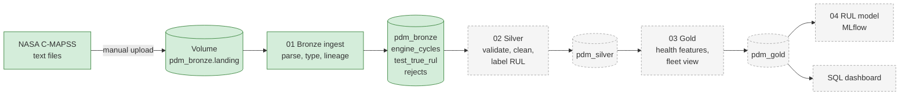

# Aircraft Maintenance Lakehouse

[](https://github.com/rashedul-karim/aircraft-maintenance-lakehouse/actions/workflows/tests.yml)

An end-to-end data pipeline for **predictive maintenance of aircraft engines**, built on Databricks with Delta Lake and Unity Catalog. It takes NASA's turbofan engine run-to-failure data from raw files to clean tables, engine-health features and a remaining-useful-life (RUL) model.

The focus is the data engineering a maintenance organisation actually needs before any model is useful: traceable ingestion, data quality checks that stop bad loads, and tables that engineers can query.

> **Status:** Week 1 of 4. Bronze layer complete. See the [roadmap](#roadmap).

## Architecture



Green is built; grey is planned.

## Stack

Databricks (Free Edition, serverless) · Delta Lake · Unity Catalog · PySpark · MLflow · GitHub Actions

## The data

The **C-MAPSS turbofan engine degradation dataset** from NASA's Prognostics Center of Excellence: simulated engines that run from normal operation until failure, with 3 operating settings and 21 sensor readings per cycle.

| Subset | Train engines | Test engines | Operating conditions | Fault modes |
|---|---|---|---|---|
| FD001 | 100 | 100 | 1 | 1 (HPC) |
| FD002 | 260 | 259 | 6 | 1 (HPC) |
| FD003 | 100 | 100 | 1 | 2 (HPC, fan) |
| FD004 | 249 | 248 | 6 | 2 (HPC, fan) |

The data is **not** stored in this repo. Download `CMAPSSData.zip` from the [NASA Open Data Portal](https://data.nasa.gov/dataset/cmapss-jet-engine-simulated-data). All data is simulated; no real or operational aircraft data is used anywhere in this project.

## Data quality findings

The bronze checks already caught one issue in the source:

- **FD004 engine counts are swapped in the dataset's readme.** It states 248 training and 249 test engines; the files contain **249 training and 248 test** engines, and `RUL_FD004.txt` has 248 values, matching the test file. The pipeline trusts the files, reports the difference, and continues.
- The readme lists columns up to "sensor measurement 26"; the files have 26 columns in total, of which **21 are sensors** (the first five are engine number, cycle and 3 operating settings).

## Bronze layer (done)

[`notebooks/01_bronze_ingest.py`](notebooks/01_bronze_ingest.py) loads every file with as little change as possible:

| Table | Rows | What it holds |
|---|---|---|
| `pdm_bronze.engine_cycles` | 265,256 | One row per engine per cycle, typed, with `dataset`, `split`, `source_file`, `ingested_at` |
| `pdm_bronze.test_true_rul` | 707 | True RUL per test engine (line N of a RUL file = engine N) |
| `pdm_bronze.engine_cycles_rejects` | 0 | Any line that fails parsing, with the reason |

Design choices:

- **Fail loudly, never silently.** The load stops if any line is rejected or if test engines and RUL values do not line up one to one.
- **Rejects are kept, not dropped.** Bad lines go to a rejects table with a reason, so the data owner can fix them.
- **Re-runnable.** Each run is a full reload of a static source, so running twice gives the same result.
- **Serverless-safe.** Only DataFrame APIs are used (no RDDs), which Databricks serverless compute requires.
- **Tested outside Databricks.** Parsing logic lives in [`src/cmapss_parsing.py`](src/cmapss_parsing.py) with unit tests that run in GitHub Actions on every push.

Full column descriptions are in [`docs/data-dictionary.md`](docs/data-dictionary.md).

## Repository structure

```
notebooks/
  00_setup.py              Create schemas and the landing volume
  01_bronze_ingest.py      Raw files -> bronze Delta tables, with checks
src/
  cmapss_parsing.py        Parsing and validation logic, shared by notebooks and tests
tests/
  test_cmapss_parsing.py   Unit tests (local PySpark)
docs/
  setup.md                 Step-by-step setup on Databricks Free Edition
  data-dictionary.md       Every table and column
.github/workflows/
  tests.yml                Runs the unit tests on every push
```

## How to run

1. Follow [`docs/setup.md`](docs/setup.md): create a Databricks Free Edition account, clone this repo as a Git folder, upload the NASA files.
2. Run `notebooks/00_setup`, then `notebooks/01_bronze_ingest`.

Run the unit tests locally (needs Java 17):

```bash
pip install -r requirements-dev.txt
pytest -q
```

## Roadmap

- [x] **Week 1 · Bronze:** ingestion, lineage, rejects, load checks, unit tests, CI
- [ ] **Week 2 · Silver:** drop constant sensors, normalise by operating condition, RUL labels for training engines, data quality rules
- [ ] **Week 3 · Gold:** rolling health features per engine, fleet health view, scheduled Databricks job
- [ ] **Week 4 · Model:** RUL regression with MLflow tracking, compared with a simple baseline, using the standard RMSE and NASA scoring function

## Dataset citation

A. Saxena, K. Goebel, D. Simon, and N. Eklund, "Damage Propagation Modeling for Aircraft Engine Run-to-Failure Simulation," *Proceedings of the 1st International Conference on Prognostics and Health Management (PHM08)*, Denver, CO, 2008.

Data provided by the NASA Prognostics Center of Excellence (PCoE).

## Licence

Code: MIT, see [`LICENSE`](LICENSE). The NASA dataset is not covered by this licence and is not redistributed here.
